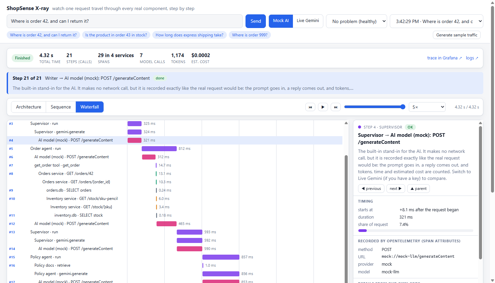
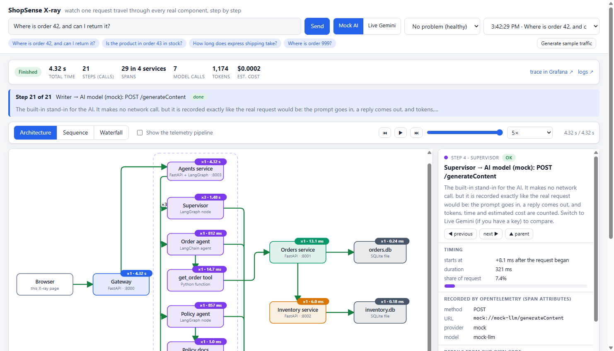
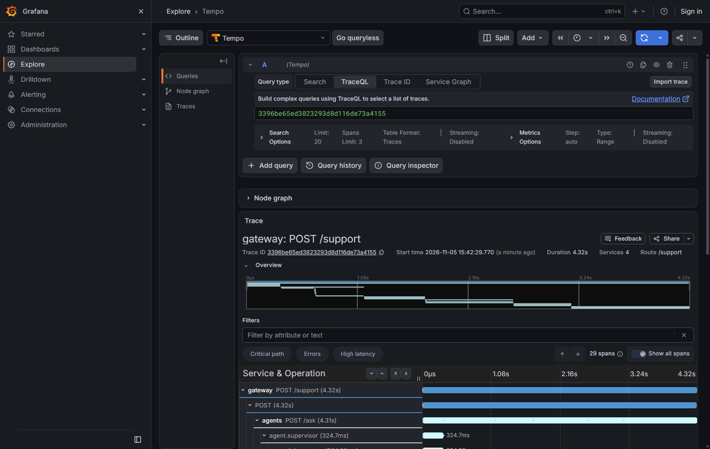
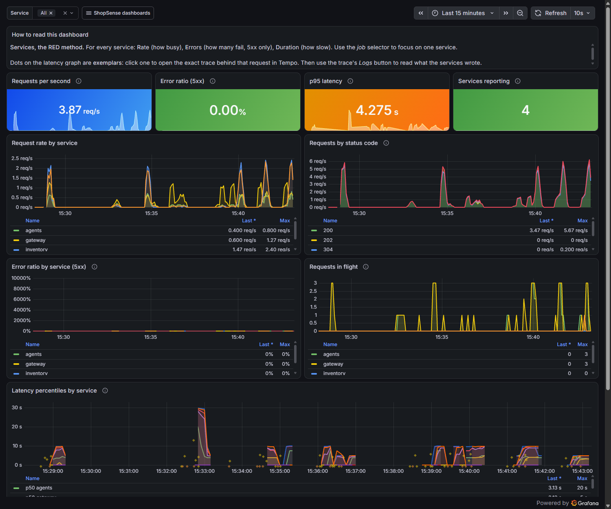
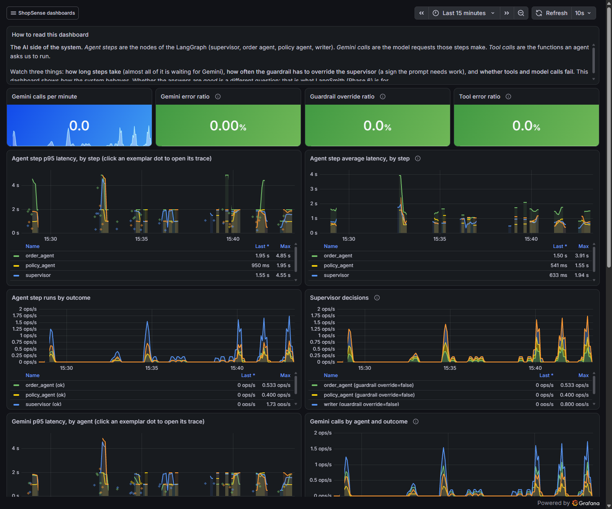

# The guided tour (about 40 minutes)

You will run the system, ask it a question, and look at that one question from five different angles.
No coding. Each stop says **what to do**, **what you should see**, and **the idea** behind it.

| Stop | You will | Time |
|---|---|---|
| 0 | Start everything | 5 min |
| 1 | Watch one question travel through the system | 6 min |
| 2 | Read what the AI was asked and what it answered | 5 min |
| 3 | Find the same request in Grafana: its trace and its logs | 6 min |
| 4 | Zoom out: dashboards, and from a spike to one request | 8 min |
| 5 | Break the system on purpose and find the cause | 10 min |
| 6 | *Optional:* answer quality, feedback and evaluations | 5 min |

## The idea in one minute

> **Observability** means: when your system does something you did not expect, you can find out *why*,
> using only the data it already gives off, without changing the code.

A running program can give off three kinds of data ("signals"):

| Signal | What it is | Good at | Not good at |
|---|---|---|---|
| **Metric** | A number over time: "42 requests per second" | *Is something wrong? How much? Since when?* | One specific request |
| **Trace** | The journey of **one** request, as a tree of timed steps (**spans**) | *Where did the time go? What called what?* | Whether this request was typical |
| **Log** | A line of text a program writes: "inventory returned 503" | *What exactly happened?* | The big picture: there are thousands of lines |

Each is a dead end alone. The trick is that every signal carries the same **trace id**, so you can start from
whichever one you notice first and walk to the others: *a metric spike → the trace behind it → the log lines it wrote.*

**Why is an AI system harder?** One question fans out into many steps. The path is chosen by the AI at run time, so
two identical questions can take different routes. Failures are often silent: the model answers fluently and wrongly,
and every health check stays green. And each model call costs time and money. So on top of the three signals, you want
to see the **prompt, the reply, the tokens and the cost** of every model call.

---

## Stop 0: start it (5 min)

```bash
python run.py up          # macOS / Linux: python3 run.py up
```

Your browser opens the **X-ray page**: <http://127.0.0.1:8000>. At the top you will see **Mock AI** selected.
That is a built-in stand-in for the AI, so you need no key and spend nothing. Everything else is real.

*Stuck? See Troubleshooting in the [README](README.md).*

---

## Stop 1: watch one question travel (6 min)

**Do:** press **Send** (the question "Where is order 42, and can I return it?" is already filled in).

**You should see:** boxes and arrows appear live as the request moves. When it finishes, the strip at the top
shows total time, **steps**, **spans**, model calls, tokens and estimated cost. Below it are three views of the same data:

| View | Shows | Use it to |
|---|---|---|
| **Sequence** | Who called whom, in order, numbered, with timings | Follow the story |
| **Waterfall** | Every step as a bar on a shared time axis | See where the time went |
| **Architecture** | The components and the lines between them, with call counts | See the shape of the system |



Press **▶** to replay it, drag the slider, or step with ⏮ ⏭. Click any box, arrow or bar to open its details on the right.

**Try:**
- Find the **three Supervisor steps**. Why three? *(The supervisor decides after every worker: first the order agent,
  then the policy agent, then the writer.)*
- Ask **"Where is order 999?"** (a missing order) and **"How long does express shipping take?"** (a different route
  through the agents). Use the **Past requests** menu to compare the three.

**The idea.** A **trace** is the recorded journey of one request: a tree of **spans**, one per timed step.
Most spans here were created **automatically** by OpenTelemetry libraries that wrap HTTP and database code, so
nobody had to write them. The ones that explain *the AI* (agent steps, tool calls, model calls) were added by hand.
The X-ray page draws exactly what OpenTelemetry recorded: nothing is simulated.



---

## Stop 2: read what the AI was asked (5 min)

**Do:** in the Sequence or Waterfall view, click a step named **"→ AI model (mock): POST /generateContent"**.

**You should see** in the right-hand panel:
- **Timing:** when it started and how long it took.
- **Recorded by OpenTelemetry:** the model name and token counts, stored as span attributes.
- **Details from our own code:** the exact **prompt** that was sent and the **reply** that came back, plus tokens and estimated cost.

Open the supervisor's prompt and find the line that tells it what to do next. Then open the **writer**'s prompt:
it contains only the facts the earlier steps gathered.

**The idea.** For AI systems, "the request took 5 s and returned 200" is not enough. You need to know *what the model
saw and said*, how many tokens that used, and what it cost. The attribute names (`gen_ai.request.model`,
`gen_ai.usage.input_tokens`) come from OpenTelemetry's standard for AI calls, so any tool that knows the standard can read them.

> **The mock is not smart.** It follows a few plain rules (which worker is still needed? is there a number in the
> question?), then fills in a template. That is on purpose: it makes every run predictable. If you have a Gemini key,
> switch to **Live Gemini** and ask the same question. Compare the replies, the time and the tokens.

---

## Stop 3: the same request in Grafana (6 min)

**Do:** above the diagram, click **trace in Grafana ↗**. Then go back and click **logs ↗**.

**You should see:**
- **Tempo** (the trace store) showing the *same* request as a tree with durations. Click a span to see its attributes.
  There are more spans here than steps in the X-ray page: the page shows only the *calls between components*.
- **Loki** (the log store) showing every log line any service wrote **while handling this request**, from all four services.



**The idea.** Four separate programs produced these. They join up because the **trace id** travels with the request in
an HTTP header (`traceparent`) from the gateway to the agents to the orders service to inventory, and every log line is
stamped with the id of the span it was written in. The **OpenTelemetry Collector** receives everything from the
services and routes each signal to the right store, so the services never need to know where data ends up.

---

## Stop 4: zoom out to dashboards (8 min)

One request tells you about one request. To know whether the system is healthy you need many.

**Do:** on the X-ray page click **Generate sample traffic**. It sends a batch of free mock questions plus some order and
stock lookups (a few deliberately fail with "not found"). When it says *Done*, wait about 15 seconds, then click
**open the dashboards ↗**.

**You should see** the **ShopSense / Services (RED)** dashboard. RED stands for **R**ate (how busy), **E**rrors
(how many fail) and **D**uration (how slow): the three numbers worth watching for any service.



**Try:**
- On **"p95 latency by route"** find the small dots. Each is an **exemplar**: a real request attached to that number.
  Click one to open its trace. This is the jump from *a metric* to *a trace*.
- Open **ShopSense / Agents and LLM** (Dashboards in the left menu). Find tokens per minute, estimated cost, the
  supervisor's decisions, and the **guardrail override ratio** (we will cause that in Stop 5).
  *(Panels say "Gemini" because they were built for the real model; in mock mode they show the mock.)*
- Why does "not found" not count as an error on the Services dashboard? *(Errors here means server failures, HTTP 5xx.
  Asking for an order that does not exist is a correct answer, not a failure.)*



**The idea.**
- **Metrics** are cheap, pre-added-up numbers, so they can be kept for a long time and drawn quickly. They cannot tell
  you about one request, which is what exemplars are for.
- Use **percentiles, not averages.** "p95 = 6 s" means 95% of requests were faster than that. An average hides the slow
  tail that real users feel.
- Metrics carry **labels** (`route`, `status`). Every distinct combination is a separate series, so a label must never
  hold something unbounded like a user id or the question text. That belongs in traces and logs.

---

## Stop 5: break it, then find it (10 min)

Observability earns its keep when something goes wrong. The **Inject a problem** menu next to the mode switch breaks
the system on purpose. For each problem below: **pick it, press Send, and try to work out what is wrong *before*
opening the hint.** Always compare with **No problem (healthy)** first.

> The menu only appears when the system was started with the default settings (`CHAOS_ENABLED` is on).

### Problem A: "Slow AI model"

*The question takes much longer. Where is the time going, and which part is slow?*

<details><summary>Hint</summary>

The total is about **14 s instead of 5 s**. In the **Waterfall**, every pink "AI model" bar is much longer; nothing
else changed. That tells you the slowness is in the model, not in the services or the database. On the **Agents and
LLM** dashboard, the model latency panels climb. This is the "is it my code, the network, or the AI?" question that
traces answer in seconds.
</details>

### Problem B: "Supervisor loops"

*The answer comes back fast and looks fine, but part of the question was never answered.*

<details><summary>Hint</summary>

Ask the default question, which has two parts (order status **and** returns). The workers that ran were
`order_agent → writer`: the **policy agent never ran**, so the reply says nothing about returns. In the trace the
supervisor picked the order agent twice; a code guardrail caught that and forced the writer. On the **Agents and LLM**
dashboard the **Guardrail override ratio** is above zero, and the logs for the request include a warning that the guardrail
overrode the supervisor. Nothing crashed and no health check failed: this is a *quiet* failure, which is typical for AI systems.
</details>

### Problem C: "Inventory down"

*The customer still gets an answer. Is anything wrong?*

<details><summary>Hint</summary>

The summary strip shows **2 ERRORS**. The reply no longer contains a "stock right now" line. In the trace, the inventory
span has status **503** and the orders service logged a warning that inventory returned an unexpected status. Orders
**degraded gracefully**: it kept going without stock data. The customer sees an answer, but a part is missing, and
only the telemetry tells you. The inventory service's `/health` still answers OK, which shows why a green health check does not
mean the system is working. On the **Services** dashboard the 5xx error ratio for inventory rises.
</details>

Pick **No problem (healthy)** when you are done.

**The idea.** A good investigation goes **metric → trace → logs**: a dashboard tells you *something* is off, the
trace tells you *where*, the logs tell you *why*. Alerts (see `infra/rules/alerts.yml` and the **SLOs and alerts**
dashboard) watch the same numbers so you do not have to; they wait a few minutes before firing, so you will not usually
see them during this tour.

---

## Stop 6 (optional): is the answer *good*? (5 min)

Speed and errors are not the same as quality. Two things measure quality:

- **Feedback:** under an answer, press 👍 or 👎. It is counted (see **User feedback by vote** on the Agents dashboard).
- **Evaluations:** run the same 20 test questions through the system and score the answers with checks. Four checks are plain code
  (did the right agent run? was the right tool called? are the key facts in the answer?). Two are an **AI judge** that grades
  tone and made-up facts, and they need a real key.

```bash
docker compose --profile app exec agents python -m evals.run_eval --local --limit 4
```

**The idea.** AI systems fail quietly, so you cannot rely on errors alone. You write down what a good answer looks like
and **measure it on every change**. If you tweak a prompt, the evaluations tell you whether answers got better or worse.

---

## What to take away

1. Observability is being able to ask *new* questions of a running system without changing it.
2. **Metrics** say *that* something is off, **traces** say *where*, **logs** say *why*. Use each for what it is good at.
3. A shared **trace id** is what turns separate tools into one investigation.
4. Instrument once with **OpenTelemetry**; store in specialist tools; explore in one place (Grafana).
5. For AI systems, also record the **prompt, reply, tokens and cost** of every model call, and measure **quality**.
6. Quiet failures (a skipped step, a missing field, a green health check) are the dangerous ones. Look for them.

## Words you met

| Word | Plain meaning |
|---|---|
| **Span** | One timed step in a request, with a name, start, duration and attributes |
| **Trace** | All the spans of one request, as a tree. Identified by a **trace id** |
| **Metric** | A number measured over time, with labels |
| **Log** | A timestamped line of text a program writes |
| **Label** | A key/value on a metric (`route="/support"`). Each combination is its own series |
| **Cardinality** | How many distinct label combinations exist. Keep it small |
| **Percentile (p95)** | The value 95% of observations are below. Describes the slow tail |
| **Exemplar** | A trace id attached to a metric data point: a link from a graph to a real request |
| **RED** | Rate, Errors, Duration: the three numbers to watch per service |
| **OpenTelemetry (OTel)** | The vendor-neutral standard and libraries for producing telemetry |
| **Collector** | A program that receives telemetry and routes it to the stores |
| **Tempo / Prometheus / Loki** | The stores for traces / metrics / logs |
| **Grafana** | The website that draws all three and links them |
| **Instrumentation** | Code that makes a program emit telemetry (automatic or hand-written) |
| **Agent** | An AI that decides what to do next and may call tools |
| **Supervisor** | The "manager" agent that picks which worker goes next |
| **Guardrail** | A rule in code that overrides the AI when it misbehaves |
| **Token** | A piece of text the model reads or writes; cost is counted per token |
| **SLO** | A promise about quality ("99% of requests succeed"), watched with alerts |

## Where to go next

- **Change something.** Edit a prompt in `services/agents/prompts.py` and see how the behaviour changes. (To edit code and
  see it right away, stop the stack and run the services yourself, as described in the README's developer section.)
- **Add a metric or a span** where you think one is missing. [ARCHITECTURE.md](ARCHITECTURE.md) tells you where.
- **Try the real model** with `GOOGLE_API_KEY`, then compare Mock and Live on the same question.
- **Read the alert and SLO rules** in `infra/rules/` and the dashboards in `infra/grafana/dashboards/`.
