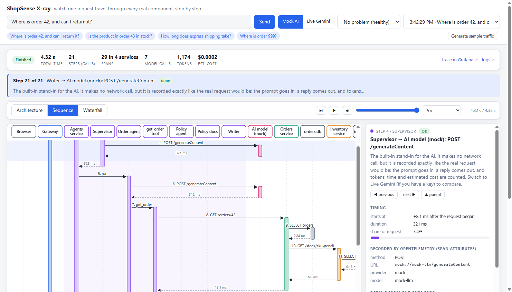

# ShopSense: learn observability by watching a multi-agent AI system work

A small customer-support chatbot made of **four services and a team of AI agents**, wired up with the same
observability stack real companies use (OpenTelemetry, Grafana, Tempo, Prometheus, Loki). You ask it a question
and watch that one question travel through every part of the system, step by step.

It is built to be **understood in 30 to 45 minutes**, by running it and clicking around. No AI account or API key
is needed: a built-in mock model stands in for the AI.



## What you will learn

- What **traces, metrics and logs** are, what each is good for, and why you need all three.
- Why **AI systems are harder to observe** than ordinary web apps: many hidden steps, a path chosen at run
  time, and answers that can be wrong without any error.
- How to follow **one request across several services**, read the **prompt and reply** of every model call,
  and see tokens and cost.
- How to go from a **dashboard spike to the exact request** behind it, and from there to its log lines.
- How to **find a problem you did not cause**: the app can break itself in three ways, and you diagnose each.

## Quick start

**You need:** [Docker Desktop](https://www.docker.com/products/docker-desktop/) (installed and *running*),
Python 3.8 or newer (only to run the launcher), and about 3 GB of free memory.
Works on **Windows, macOS and Linux**.

```bash
git clone https://github.com/subhan75/Multi-Agent-Observability.git
cd Multi-Agent-Observability
python run.py up          # on macOS / Linux: python3 run.py up
```

The first run downloads images and builds the services, which takes a few minutes. When it is ready your
browser opens the **X-ray page** at <http://127.0.0.1:8000>. Press **Send**, then follow **[LEARN.md](LEARN.md)**,
a guided tour of about 40 minutes.

When you are done:

```bash
python run.py down        # stops everything and removes containers, network and stored data
```

`down` checks that nothing of ShopSense is left running or holding a port, and tells you if something is.
Add `--keep-data` to keep the stored metrics and traces, or `--images` to also delete the built image.
`python run.py status` shows what is running.

## How it fits together

```
 Browser (X-ray page)
    |
    v
 gateway :8000 ---> agents :8003 (LangGraph) ---> orders :8001 ---> inventory :8002
                       supervisor -> order agent / policy agent -> writer         |
                       each worker may call the AI model                          v
                                                                              SQLite files
 Every service sends traces, metrics and logs (OpenTelemetry)
    |
    v
 OpenTelemetry Collector ---> Tempo (traces)  Prometheus (metrics)  Loki (logs)
                                       \            |             /
                                        '----> Grafana (dashboards, links between them)
```

See [ARCHITECTURE.md](ARCHITECTURE.md) for a map of the code.

## Mock AI or live Gemini?

The page has a **Mock AI / Live Gemini** switch next to the Send button.

| | Mock AI (default without a key) | Live Gemini |
|---|---|---|
| Needs an API key | No | Yes, `GOOGLE_API_KEY` in a `.env` file |
| Cost | Free | A few model calls per question |
| What is real | Everything except the model: HTTP calls between services, database queries, tool calls, traces, metrics, logs | Everything |
| Answers | Rule-based and predictable | Written by the model |

The mock is not intelligent. It follows a few simple rules so the system behaves the same every time, which makes
it ideal for learning. To also try the real model, copy `.env.example` to `.env`, put your key in it, and run
`python run.py up` again. **Live** then becomes available and is the default.

## Where things are

| What | Where |
|---|---|
| **X-ray page** (start here) | <http://127.0.0.1:8000> |
| Grafana (dashboards, traces, logs) | <http://127.0.0.1:3000> |
| Prometheus | <http://127.0.0.1:9090> |

Other ports: orders 8001, inventory 8002, agents 8003, Loki 3100, Tempo 3200, OpenTelemetry Collector 4317/4318/8889.
Everything is published on `127.0.0.1` only, so it is reachable from your computer and not from your network.
If a port is taken, `run.py up` tells you which one. You can move the services and Grafana with
`GATEWAY_PORT`, `ORDERS_PORT`, `INVENTORY_PORT`, `AGENTS_PORT` and `GRAFANA_PORT`
(for example `GRAFANA_PORT=3300 python3 run.py up`).

## Troubleshooting

| Problem | Fix |
|---|---|
| "Docker is installed but not running" | Start Docker Desktop and wait until it says it is running. |
| "These ports are already in use" | Close the program using them, or move the port (see above). |
| `up` fails or hangs | `docker compose --profile app logs --tail 50`, then `python run.py down` and try again. |
| **Live Gemini** is greyed out | No API key was found. Add `GOOGLE_API_KEY` to `.env` and run `python run.py up` again. |
| Grafana panels are empty | Click **Generate sample traffic** on the X-ray page, wait about 15 seconds, refresh. |
| Apple Silicon (M1/M2/M3) Mac | Supported: every image has an arm64 build. |

## Safe to run, not safe to publish

This is a **local learning lab**. Do not put it on the internet.

- Grafana allows anonymous admin access so there is no login screen.
- The services have no authentication, and the X-ray page keeps full prompts and replies in memory.
- Nothing limits how often you can ask a question. In Live mode, every question costs real money.
- If you turn on LangSmith tracing (optional, in `.env`), questions and answers are sent to LangSmith.

## Run the services from source (to edit the code)

Docker builds the code into an image, so edits need a rebuild (`python run.py up` does that). To change code and see
it right away, run the observability stack in Docker and the four services yourself:

```bash
python -m venv .venv
source .venv/bin/activate              # Windows PowerShell: .venv\Scripts\Activate.ps1
pip install -r requirements.txt
docker compose up -d                   # the observability stack only

# then, each in its own terminal (Windows: scripts
un_all.cmd starts all four for you):
python -m uvicorn services.inventory.main:app --port 8002
python -m uvicorn services.orders.main:app --port 8001
python -m uvicorn services.agents.main:app --port 8003
python -m uvicorn services.gateway.main:app --port 8000
```

Open <http://127.0.0.1:8000>. Stop with Ctrl+C in each terminal and `docker compose down`.
To get the "inject a problem" menu in this setup, `export CHAOS_ENABLED=1` (PowerShell: `$env:CHAOS_ENABLED=1`) in every terminal first.

## For developers

```bash
# Run the tests (offline: no Docker, no API key)
pip install -r requirements-dev.txt
python -m pytest
```

- Plain `docker compose up -d` still starts only the observability stack (Grafana, Tempo, Prometheus, Loki,
  Collector). `docker compose --profile app up` adds the four services.
- Environment variables worth knowing: `LLM_MODE` (`mock` or `live`), `MOCK_LLM_LATENCY_MS` (for example `300-1200`,
  or `0`), and `CHAOS_ENABLED` (`0` hides the "inject a problem" menu). See `.env.example`.
- Evaluate answers: `docker compose --profile app exec agents python -m evals.run_eval --local --limit 4`.
  The code checks run with the mock; the two AI-judge columns need a real key.
